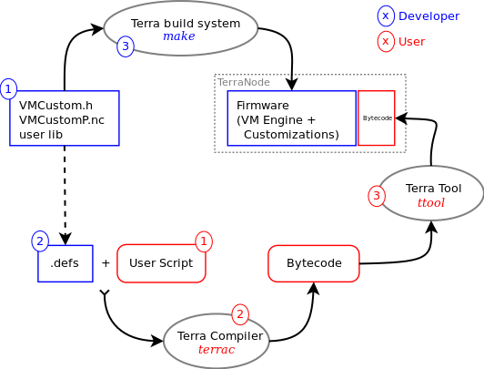

# Creating a custom VM

The events, functions and types that a Terra program sees are not fixed by the language: they
come from the components built into the VM. [TerraNet](terranet.html) and
[TerraGrp](terragrp.html) are two such *customizations*. Most sensor network applications are
variations of a monitoring and control pattern, and a small library of components (sensors,
actuators, radio, groups, aggregation) covers a wide range of them. New components can be added
to create abstractions for other patterns.

This page explains how to add an event or a function to a VM. It assumes some familiarity with
nesC and with the [Terra language](language.html). The code of a VM runs in the event-driven
model of TinyOS: **a custom operation must never block**. It starts the work and returns; the
result comes later as an input event.



## The files

A customization is described in three places, which must agree:

| File | What it has |
|---|---|
| `TerraVM/src/defs/Terra<XXX>.defs.in` | the model of the `.defs`: events, functions, types and constants, as the compiler sees them |
| `TerraVM/src/CustomVMs/Terra<XXX>/VMCustom<XXX>.h` | the numeric ids of the events and functions, as the VM sees them |
| `TerraVM/src/CustomVMs/Terra<XXX>/VMCustomP.nc` | the code of the output events and functions, and the places that signal the input events |

`<XXX>` is `Net` or `Grp`. Names may differ between the `.defs` and the VM; what must be equal
is the numeric id of each event and function, and the type and order of the fields of each
data structure.

Two more files take part:

- `TerraVM/src/defs/descricoes.toml`: the description of each symbol, for the documentation and
  for editors (`terra-docs.json`). The release build fails if a symbol has no description.
- `terrac/samples/Terra<XXX>.defs`: the `.defs` of the simulator, distributed with the compiler.
  It is generated by the build; the release build fails if the committed one differs.

## The .defs model

The `.defs` of each firmware is generated by the build (`TerraVM/src/defs/gendefs.py`) from the
model. Lines between `//@if FLAG` and `//@endif` enter only the firmware that has that feature:

| Flag | When |
|---|---|
| `MSGQ` | `MOD=MSGQ` (message queue) |
| `FFT` | `MOD=FFT` |
| `PORTS` | mica motes (not the simulator): digital ports and interrupts |
| `MIC` | mica motes with the MTS300 sensor board (`SENSOR=MTS300CA/CB`) |

`@NAME@`, `@PLATFORM@` and `@MEM@` in the `config` block are replaced by the name of the VM, the
platform and the memory for programs of the build. A declaration that depends on a feature must
be inside the same condition in the model and in the code of the VM (the C macros are
`M_MSG_QUEUE`, `M_FFT`, `TERRA_PORTS` and `TERRA_MIC`): the `.defs` declares only what the firmware
has. The release build checks it with `release/check-defs.py`: every output event and function of
a generated `.defs` must have a `case` in the VM, and every input event must be signaled
somewhere.

Do not write comments starting with `/**` in a `.defs`: the compiler does not read them.

### Constants

```c
#define HIGH 1
#define LOW  0
```

### Data structures

A `regtype` is a record of basic types or arrays. A `packet` is an abstract record with a
`payload[N]` field, which the program fills with its own fields through `pktype` (radio messages
are packets: a fixed header and an application payload).

```c
regtype dhtData_t with
    var ubyte stat;
    var ubyte hum;
    var ubyte temp;
end

packet radioMsg with
    var ubyte   type;
    var ushort  source;
    var ushort  target;
    var payload[20] data;
end
```

An event or a function that takes a record receives its **address** in the VM memory, not the
values.

### Output events

```c
output void EVENT_NAME ArgumentType NumericId;
output void REQ_DHT ubyte 10;
```

The name is in upper case. The argument is a basic type, `void` or a data structure. The id is
unique among the output events.

### Input events

```c
input ReturnType EVENT_NAME ArgumentType NumericId;
input ubyte SEND_DONE ubyte 40;
input ubyte SEND_DONE void  41;
```

The return type is what `await` gives: a basic type or a data structure. The argument is `ubyte`
or `void`: the form with `ubyte` is `await EVENT(x)`, which waits only for the occurrences whose
*sub-event* is x (for example, the type of a message). An event with both forms has two
declarations, with two ids. The id is unique among the input events.

### Functions

```c
function [pure|nohold] ReturnType functionName(ArgumentTypes) NumericId;
function pure ushort getNodeId() 0;
function ubyte pinWrite(ubyte, ubyte, ubyte) 21;
```

The name starts in lower case. The return type is a basic type. The arguments are basic types or
data structures. The id is unique among the functions.

- `pure`: the function only reads, so two trails may call it in the same reaction.
- `nohold`: the function does not keep the addresses it receives after it returns.

Without them, two calls in parallel trails give a nondeterminism warning.

### Nondeterminism

```c
unsafe LED0 with LEDS, LED0, LED1, LED2;
```

Two trails that use these events in the same reaction get a warning (W2001). Declare as
`unsafe` the operations whose order changes the result, or that the hardware cannot serve at the
same time.

## The ids in VMCustom&lt;XXX&gt;.h

```c
enum {
    O_DHT          = 10,   // output events
    O_SEND         = 40,
    I_DHT          = 6,    // input events
    I_SEND_DONE_ID = 40,   //   the form with argument
    I_SEND_DONE    = 41,   //   the form without argument
    F_GETNODEID    = 0,    // functions
    F_PIN_WRITE    = 21,
};
```

The ids must be unique only inside each group (output events, input events, functions).

## The code in VMCustomP.nc

### Data structures

Each structure of the `.defs` has an equivalent `nx_struct` in nesC, with the same fields in the
same order. The VM memory is big-endian (network types):

| Terra | nesC | Terra | nesC |
|---|---|---|---|
| `ubyte` | `nx_uint8_t` | `byte` | `nx_int8_t` |
| `ushort` | `nx_uint16_t` | `short` | `nx_int16_t` |
| `ulong` | `nx_uint32_t` | `long` | `nx_int32_t` |
| `float` | `nx_float` | | |

```c
typedef nx_struct dhtData {
    nx_uint8_t stat;
    nx_uint8_t hum;
    nx_uint8_t temp;
} dhtData_t;
```

### Output events

`emit EVT(arg)` calls `VM.procOutEvt(id, value)`. `value` is the argument, or the address of a
data structure: get the pointer with `VM.getRealAddr`.

```c
void proc_req_dht_read(uint16_t id, uint32_t value) {
    call dht.read((uint8_t)value);          // starts the reading; DHT comes later
}
void proc_send(uint16_t id, uint32_t addr) {
    usrMsg_t* usrMsg = (usrMsg_t*)signal VM.getRealAddr(addr);
    // ...
}

command void VM.procOutEvt(uint8_t id, uint32_t value) {
    switch (id) {
        case O_DHT  : proc_req_dht_read(id, value); break;
        case O_SEND : proc_send(id, value); break;
    }
}
```

### Functions

A function call runs `VM.callFunction(id)`. The arguments are on the VM stack: pop them in
reverse order (the last one first) with `VM.pop()`, casting to the type; a data structure comes
as its address (pop it as `uint16_t` and use `VM.getRealAddr`). Push exactly one result, of the
type declared in the `.defs`, with `VM.push()`: a function that does not push leaves the stack
out of balance.

```c
void func_pinWrite(uint16_t id) {
    uint8_t val  = (uint8_t)signal VM.pop();   // 3rd argument
    uint8_t pin  = (uint8_t)signal VM.pop();   // 2nd argument
    uint8_t port = (uint8_t)signal VM.pop();   // 1st argument
    signal VM.push(pinWrite(port, pin, val));
}

command void VM.callFunction(uint8_t id) {
    switch (id) {
        case F_GETNODEID : func_getNodeId(id); break;
        case F_PIN_WRITE : func_pinWrite(id); break;
    }
}
```

### Input events

An input event starts outside the VM (a nesC event, a callback, an interrupt) and is passed to it
with `VM.queueEvt(id, subEvent, buffer)`. If no trail is waiting for it, the VM discards it.

- **The sub-event** is the value that `await EVT(x)` compares with x. An event with both forms
  is queued twice: with the form's id and the sub-event, and with the id of the form without
  argument and 0.
- **The buffer** keeps the value until the VM handles the event, later: it must be a global
  variable, one per event, and its size must be the size of the type that the `.defs` declares
  for the event (a `ubyte` event needs a `nx_uint8_t` buffer). The VM copies that many bytes
  from it to the program.
- If another occurrence can arrive before the VM handles the previous one, use more than one
  buffer (TerraNet keeps two for `RECEIVE`). Mind the RAM of small motes.

```c
dhtData_t ExtDHTData;
event void dht.readDone(dhtData_t* data) {
    memcpy(&ExtDHTData, data, sizeof(dhtData_t));
    signal VM.queueEvt(I_DHT, 0, &ExtDHTData);
}

nx_uint8_t ExtDataSendDoneError;
event void BSRadio.sendDone(uint8_t am_id, message_t* msg, void* dataMsg, error_t error) {
    if (am_id == AM_USRMSG) {
        ExtDataSendDoneError = (uint8_t)error;
        signal VM.queueEvt(I_SEND_DONE_ID, ((usrMsg_t*)dataMsg)->type, &ExtDataSendDoneError);
        signal VM.queueEvt(I_SEND_DONE, 0, &ExtDataSendDoneError);
    }
}
```

## Checking a new customization

1. Build the firmware and the simulator (see [Building from the source](tinyos.html#building-from-the-source)).
   The build generates the `.defs` and runs `release/check-defs.py`.
2. Copy the `.defs` of the simulator to `terrac/samples/` and add the descriptions to
   `TerraVM/src/defs/descricoes.toml`.
3. Write a test program that uses the new events and functions and check it in the simulator
   (the tests in `tests/*/` load a program and read the LEDs of the nodes), and on the mote or in
   the Avrora emulator (`tests/avrora/`).
