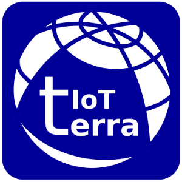

# Terra IoT System

Terra is a programming system for wireless sensor networks and small IoT devices. A small
virtual machine runs on each node and is programmed in **Céu-T**, a reactive scripting language:
programs react to events (sensor readings, radio messages, timers) and the compiler checks that
every reaction ends and warns about nondeterminism. The VM is small enough for 8-bit
micro-controllers with a few KB of RAM, and new programs are sent to the nodes over the radio.

Terra was created by Adriano Branco at PUC-Rio, in his PhD: the research, the teaching with Terra and
the publications are on the [research page](https://www.inf.puc-rio.br/~prjterra/). Contact: 

## Documentation

- [Getting started](getting-started.html): install, write, compile and simulate a program, then
  run it on micaz motes.
- [The Terra language](language.html): types, flow control, events, timers, patterns.
- [TerraNet](terranet.html): the VM with radio messages to the nodes in range.
- [TerraGrp](terragrp.html): the VM with groups, leader election and aggregation.
- [terrac](terrac.html): the compiler, its options and diagnostics; [error codes](terrac-codes.html).
- [TinyOS platform](tinyos.html): building the firmware, installing it on the motes.
- [Customization](customization.html): how to create a new VM with other events and functions.

This site documents the latest release. Older versions are in the repository history.

## Getting Terra

On Linux, the extension for VS Code `terra-vscode-<version>-linux-x64.vsix`, or the package
`terra-<version>-linux-x86_64.tar.gz` for the terminal, has everything inside: nothing to install,
no administrator needed ([Getting started](getting-started.html)).

The [releases](https://github.com/afbranco/Terra/releases) of the
[repository](https://github.com/afbranco/Terra) have also the pieces one by one: the compiler
(`terrac`), the TOSSIM simulator modules (Python 3), the micaz firmware and its `.defs`,
`terractl` (loads programs, shows the messages of the network, flashes the micaz and runs a local
simulation), an extension for VS Code (`terra-vscode-<version>.vsix`: highlighting, the documentation
on hover, the errors of `terrac` in place, and the `terractl` commands), and `terra-docs-<version>.json`, the description of every symbol of the VMs
for editors.

Supported platform: TinyOS 2.1.2 (micaz and the TOSSIM simulator; the firmware builds also for
other mica, iris and telosb motes). Between 2016 and 2018 Terra was also ported to Linux/RPi,
Android, ESP8266 and Arduino Mega, to study the integration of heterogeneous platforms with the
Terra VM as a common layer; that work is in the
[integracao-heterogenea](https://github.com/afbranco/Terra/tree/integracao-heterogenea) branch.

**TerraSim** is a web simulator for teaching, based on the Terra releases: write a program, run
it on a simulated network and watch the nodes. It runs at
[terrasim.inf.puc-rio.br](https://terrasim.inf.puc-rio.br) (access by invitation); the source is
on [GitHub](https://github.com/afbranco/TerraSim).

Terra is free software, under the [GPL v3](license.html).

## How to cite

Adriano Branco, Francisco Sant'Anna, Roberto Ierusalimschy, Noemi Rodriguez and Silvana Rossetto.
**Terra: Flexibility and safety in wireless sensor networks.** *ACM Transactions on Sensor
Networks*, 11(4):59:1-59:27, 2015. [doi:10.1145/2811267](https://doi.org/10.1145/2811267)

The BibTeX, the article on Céu and the other works are in [Publications](publications.html).
